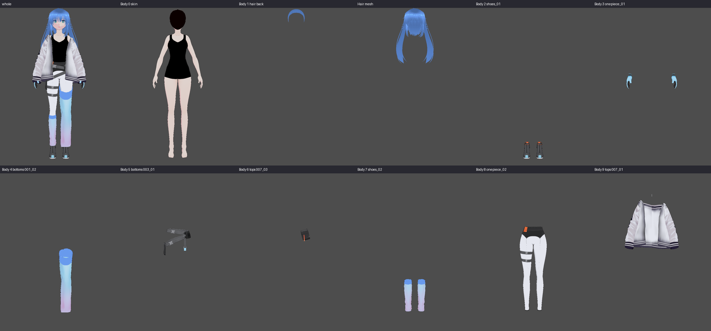

# Outfit inventory of the character (imported VRM)

Made with `ui/godot/tools/dump_outfit.gd` (data: `outfit_surfaces.jsonl`) and `ui/godot/tools/outfit_sheet.gd` (the picture: `outfit_sheet.png`, every surface on its own). Input for the character variants (`REQUIREMENTS_CORE.md` 7).



## Finding

- The clothes are **separate geometry**: every part is its own surface (material slot) with its own triangles, so each can be hidden or recoloured on its own. No Blender work is needed for that.
- The meshes are `Body` (10 surfaces: skin, a hair strip and 8 clothing parts), `Face` (8 surfaces, 57 blend shapes: mouth, iris, highlight, skin, eye white, brow, eyelash, eyeline) and `Hair` (1 surface).
- Object and material names do not say what a part is (`Onepiece` is the gloves and the leggings). **The key of a part is `<mesh>/<surface index>`** together with the material name.
- The black top and shorts are painted into the skin texture: they cannot be taken off.
- Colour: every part has `_Color` (multiplies the texture) and `_ShadeColor` (the shadow side). A tint works on the white parts (jacket, leggings) and badly on strongly coloured textures (the blue hair, the gradient stockings): those need another texture (a hue-shifted copy made once, offline).
- **There are no accessories** in the model (no glasses, hat, headphones, book). They have to come from outside the VRM: small procedural shapes attached to bones (`BoneAttachment3D`: glasses on the head, a book in the hand) or props made in Blender and loaded as separate `.glb` files at run time.

## Surfaces

| Key | Material | Triangles | Height (m) | What it is | Variant use | Note |
|---|---|---|---|---|---|---|
| Body/0 | N00_000_00_Body_00_SKIN | 10934 | 0.01 to 1.71 | skin, with a black one-piece top and shorts painted into the texture | tint only | the underwear is part of the skin texture: it cannot be hidden without editing the texture |
| Body/1 | N00_000_00_HairBack_00_HAIR | 1408 | 1.47 to 1.71 | a small strip of hair at the back of the head | texture | belongs to the hair: change it together with the Hair mesh |
| Body/2 | N00_008_01_Shoes_01_CLOTH_01 | 740 | 0.00 to 0.16 | boots (dark, orange and blue accents) | tint or hide |  |
| Body/3 | N00_010_01_Onepiece_00_CLOTH_01 | 2036 | 1.28 to 1.41 | gloves (blue gradient) | texture | the name says one-piece, the content is the gloves |
| Body/4 | N00_001_02_Bottoms_01_CLOTH | 493 | 0.07 to 0.89 | one stocking or leg piece, blue gradient (one leg) | texture or hide | asymmetric on purpose |
| Body/5 | N00_003_01_Bottoms_01_CLOTH | 193 | 0.76 to 1.10 | thigh belt with a holster strap | tint or hide |  |
| Body/6 | N00_007_03_Tops_01_CLOTH | 64 | 0.93 to 1.12 | a small pouch | hide | 64 triangles |
| Body/7 | N00_008_01_Shoes_01_CLOTH_02 | 864 | 0.12 to 0.51 | leg warmers, blue gradient (both lower legs) | texture or hide |  |
| Body/8 | N00_010_01_Onepiece_00_CLOTH_02 | 2669 | 0.05 to 1.29 | white leggings with black shorts and a thigh strap | tint (white texture) | the name says one-piece, the content is leggings and shorts |
| Body/9 | N00_007_01_Tops_01_CLOTH | 2555 | 0.82 to 1.50 | white bomber jacket with striped cuffs | tint (white texture) or hide | the largest clothing part |
| Face/0 | N00_000_00_FaceMouth_00_FACE | 1696 | 1.49 to 1.51 | face part | (not for outfits) |  |
| Face/1 | N00_000_00_EyeIris_00_EYE | 418 | 1.54 to 1.58 | face part | (not for outfits) |  |
| Face/2 | N00_000_00_EyeHighlight_00_EYE | 327 | 1.54 to 1.59 | face part | (not for outfits) |  |
| Face/3 | N00_000_00_Face_00_SKIN | 4232 | 1.47 to 1.70 | face part | (not for outfits) |  |
| Face/4 | N00_000_00_EyeWhite_00_EYE | 528 | 1.54 to 1.58 | face part | (not for outfits) |  |
| Face/5 | N00_000_00_FaceBrow_00_FACE | 56 | 1.58 to 1.60 | face part | (not for outfits) |  |
| Face/6 | N00_000_00_FaceEyelash_00_FACE | 76 | 1.56 to 1.58 | face part | (not for outfits) |  |
| Face/7 | N00_000_00_FaceEyeline_00_FACE | 172 | 1.54 to 1.58 | face part | (not for outfits) |  |
| Hair/0 | N00_000_Hair_00_HAIR | 25346 | 1.09 to 1.75 | the hair: two long twin tails, blue | texture | 25346 triangles; the colour is in the texture, not in a colour parameter |

## What this means for the variants (requirements 7)

A variant is data. Proposed fields (the first two need only what the model already has):

```json
{
 "name": "researcher",
 "description": "the researcher: jacket off, glasses, a notebook",
 "surfaces": {
  "Body/9": {
   "visible": false
  },
  "Body/8": {
   "color": "#e8f0ff"
  },
  "Body/2": {
   "color": "#303030"
  }
 },
 "textures": {
  "Hair/0": {
   "_MainTex": "variants/hair_green.png"
  }
 },
 "props": [
  {
   "kind": "glasses",
   "bone": "Head",
   "color": "#222222"
  },
  {
   "kind": "notebook",
   "bone": "LeftHand"
  }
 ]
}
```

- `surfaces`: hide a part (a transparent material override: tried, outline pass included) or tint it (`_Color`, `_ShadeColor`).
- `textures`: another texture for a surface (recoloured offline, shipped as a file; also the way to recolour the hair).
- `props`: small shapes attached to a bone, from a short list built in code (glasses, hat, headphones, notebook), or a `.glb` made in Blender (`{"scene": "props/book.glb", "bone": "RightHand"}`).
- Expressions and gestures are not affected: the blend shapes are on the `Face` mesh, the pose is on the skeleton.
